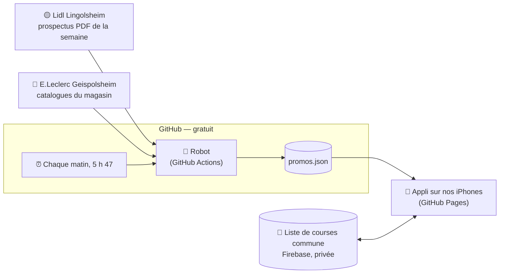
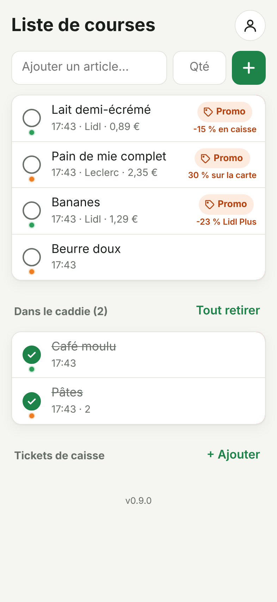
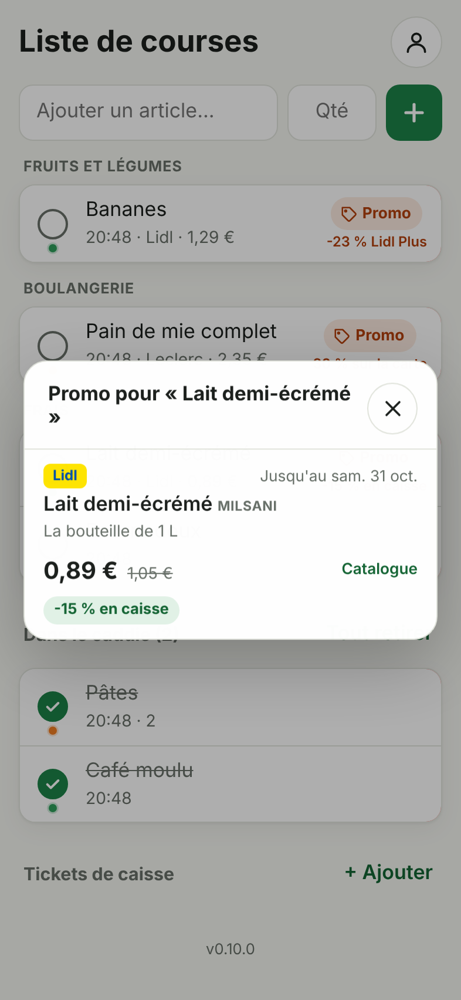
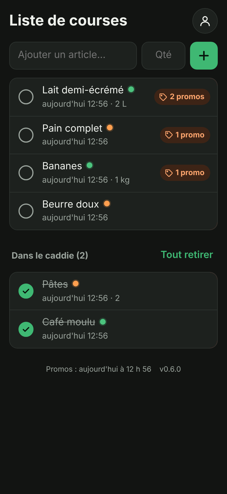

# 🛒 Promos courses

**Notre liste de courses qui trouve toute seule les promos de nos magasins.**

Chaque matin, un robot lit les catalogues de **Lidl Lingolsheim** et d'**E.Leclerc Geispolsheim**
et range toutes les promos dans un fichier. Une appli sur nos deux iPhones garde notre liste de
courses commune et la compare à ces promos pour dépenser le moins possible, sans rien faire au
quotidien.

**👉 L'appli : https://lascampia67.github.io/promos-courses/** (réservée à nos deux comptes) —
[l'installer sur l'iPhone](docs/installation-iphone.md)

[](https://github.com/lascampia67/promos-courses/actions/workflows/robot.yml)
[](https://github.com/lascampia67/promos-courses/actions/workflows/tests.yml)
[](https://github.com/lascampia67/promos-courses/actions/workflows/regles.yml)
[](https://github.com/lascampia67/promos-courses/actions/workflows/appli.yml)
[](https://github.com/lascampia67/promos-courses/releases/latest)
[](https://github.com/lascampia67/promos-courses/releases)


> [!NOTE]
> Projet personnel, en service depuis le 27/10/2026 : le robot, la liste de courses commune, la
> comparaison avec les promos et l'appli installée sur nos deux iPhones fonctionnent.

## Sommaire

- [Où en est le projet](#où-en-est-le-projet)
- [Comment ça marche](#comment-ça-marche)
- [Les magasins et les sources](#les-magasins-et-les-sources)
- [L'appli](#lappli)
- [Au quotidien](#au-quotidien)
- [Le fichier promos.json](#le-fichier-promosjson)
- [Fiabilité](#fiabilité)
- [Règles respectées](#règles-respectées)
- [Dépannage](#dépannage)
- [Pour les développeurs](#pour-les-développeurs)
- [Versions](#versions)
- [Limites connues](#limites-connues)
- [Aide et contact](#aide-et-contact)
- [Licence](#licence)

## Où en est le projet

| Étape | Description | État |
|---|---|---|
| 1 | Choisir les magasins | ✅ Fait |
| 2 | Tester les sources de promos | ✅ Fait |
| 3 | Créer le robot qui récupère les promos | ✅ Fait et validé (version 0.2.0) |
| 4 | Créer l'appli (liste de courses commune + comparaison aux promos) | ✅ Fait et validé (version 0.4.0) |
| 5 | L'installer sur nos deux iPhones | ✅ Fait et validé (version 0.5.0) |

Dernière mise à jour de ce tableau : 27/10/2026. Le détail des évolutions est dans le
[journal des versions](CHANGELOG.md).

## Comment ça marche



1. **Chaque matin à 5 h 47** (heure de Paris), GitHub lance le robot tout seul. Si GitHub l'oublie
   (cela arrive quand ses serveurs sont surchargés), des rattrapages sont prévus à 8 h 17 et 12 h 37 :
   ils ne font rien si le robot est déjà passé dans la journée.
2. Le robot regarde la liste des catalogues de chaque magasin. Il ne relit un catalogue que **s'il a
   changé** depuis la veille.
3. Il en extrait chaque promo : produit, marque, prix, ancien prix, réduction, prix au kilo,
   conditions (carte de fidélité, « 2e à -60 % »…), dates.
4. Il vérifie que tout est au bon format, puis enregistre le fichier [`promos.json`](promos.json)
   dans ce dépôt.
5. L'appli lit ce fichier et signale les articles de la liste qui sont en promo. La liste de courses,
   elle, n'est **pas** stockée ici (ce dépôt est public) mais dans une base **Firebase** privée et gratuite, réservée à nos deux comptes :
   voir [docs/liste-commune.md](docs/liste-commune.md).

## Les magasins et les sources

| Magasin | Source | Ce qu'on obtient |
|---|---|---|
| **Lidl Lingolsheim** | Prospectus PDF officiel de Lidl France (semaine en cours et suivante) | Tous les produits du prospectus : prix, ancien prix, réduction, Lidl Plus, prix au kilo, lots, dates de chaque page. Environ 500 promos par jour. |
| **E.Leclerc Geispolsheim** | Catalogues officiels du magasin (n° 1067) | Tous les catalogues en cours et à venir : prix, prix barré, « 2e à -X % », « 2 + 1 offert », Ticket E.Leclerc, prix au kilo, code-barres, photo. Environ 1 400 promos par jour. |

Le détail (adresses consultées, choix faits, sources écartées) est dans
[docs/sources.md](docs/sources.md).

## L'appli

Une appli web pensée pour l'iPhone, publiée gratuitement par GitHub Pages :
**https://lascampia67.github.io/promos-courses/**

| Liste | Promos d'un article | Mode sombre |
|---|---|---|
|  |  |  |

- **Liste commune** : ce que l'un ajoute, coche ou supprime apparaît aussitôt sur l'autre téléphone.
- **Promos** : un article en promo chez Lidl ou Leclerc porte une étiquette « 2 promos ». En la
  touchant, on voit chaque promo : magasin, prix, ancien prix, réduction, prix au kilo, prix par lot,
  carte de fidélité, et jusqu'à quand (ou à partir de quand, pour les promos à venir).
- **Promos à jour** : l'appli prévient si le robot n'est pas passé ou si un magasin manque.
- **Ajout rapide** avec quantité facultative ; un article déjà dans la liste est signalé.
- **Caddie** : un article coché passe dans « Dans le caddie » ; « Tout retirer » vide le caddie.
- **Marche sans réseau** (au fond du magasin) : les changements partent au retour du réseau.
- **Privée** : seuls nos deux comptes peuvent s'y connecter.
- **Installable sur l'iPhone**, sans App Store : icône sur l'écran d'accueil, plein écran, mises à
  jour automatiques. Dans Safari, l'appli explique elle-même comment faire.

Mode d'emploi, fonctionnement et tests : [docs/appli.md](docs/appli.md). Installation sur l'iPhone,
pas à pas : [docs/installation-iphone.md](docs/installation-iphone.md).

## Au quotidien

**Il n'y a rien à faire.** Le robot tourne tout seul chaque matin.

### Voir le résultat du dernier passage

1. Ouvrir l'onglet [**Actions**](https://github.com/lascampia67/promos-courses/actions) du dépôt.
2. Cliquer sur le dernier lancement de **Robot des promos**.
3. En bas de la page, le tableau **Résultat du robot** indique, pour chaque magasin, le nombre de
   promos et chaque catalogue lu.

### Lancer le robot à la main

1. Onglet **Actions** → **Robot des promos** (dans la colonne de gauche).
2. Bouton **Run workflow** à droite.
3. Cocher « Relire tous les catalogues » seulement si on veut tout relire (sinon laisser décoché).
4. Cliquer sur le bouton vert **Run workflow**. Le résultat arrive en 1 à 3 minutes.

## Le fichier promos.json

Un seul fichier, à la racine du dépôt, réécrit chaque matin. Il contient :

- la date et l'heure du passage du robot ;
- l'état de chaque source (`ok`, `partiel` ou `erreur`) et la liste des catalogues lus ;
- toutes les promos en cours **et à venir** (les promos terminées sont retirées).

Exemple d'une promo (extrait) :

```json
{
  "magasin": "lidl-lingolsheim",
  "produit": "Cervelas",
  "marque": "SAINT ALBY",
  "prix": 2.65,
  "prix_unitaire": 6.63,
  "unite": "kg",
  "reduction": "-40 % sur le 2e avec Lidl Plus",
  "lot": { "quantite": 2, "prix": 4.24, "prix_unitaire": 5.3 },
  "carte_fidelite": true,
  "date_debut": "2026-10-22",
  "date_fin": "2026-10-28"
}
```

Ici, un cervelas coûte 2,65 € (6,63 €/kg) ; en en prenant 2 avec Lidl Plus, on paie 4,24 € (5,30 €/kg).
L'appli affiche ces deux prix au kilo côte à côte pour juger si le lot vaut vraiment le coup.

Tous les champs sont expliqués dans [docs/format-promos.md](docs/format-promos.md). Le format exact
est décrit par un schéma JSON : [`promos.schema.json`](src/robot_promos/promos.schema.json).

## Fiabilité

- **Une source en panne n'arrête pas les autres.** Elle est marquée `erreur` ou `partiel` et ses
  promos de la veille encore valables sont conservées.
- **Si toutes les sources sont en panne**, `promos.json` n'est pas modifié (on garde le précédent).
- **Pannes passagères** : le robot réessaie automatiquement deux fois en attendant un peu.
- **Lancement oublié par GitHub** : rattrapages à 8 h 17 et 12 h 37, sans jamais faire plus d'un
  passage par jour sur les sites.
- **Format vérifié** : avant d'être enregistré, `promos.json` est contrôlé par son schéma JSON.
- **Tests automatiques** à chaque modification : plus de 50 tests pour le robot (workflow « Tests »),
  15 tests qui vérifient que la liste commune reste réservée à nos deux comptes (« Règles Firebase »),
  35 tests de logique de l'appli et 11 scénarios réels dans Chrome et Safari, avec deux téléphones
  simulés et des promos d'exemple (« Appli »).
  Si un test de l'appli échoue, elle n'est pas publiée.
- **Alerte** : en cas de problème, un avertissement s'affiche sur la page du lancement (onglet
  Actions) et GitHub envoie un e-mail si le lancement échoue.

## Règles respectées

- Le robot lit le fichier `robots.txt` de chaque site et ne visite jamais une page interdite.
- Un seul passage par jour, au moins 3 secondes entre deux visites, et un catalogue inchangé n'est
  pas retéléchargé.
- Le robot se présente sous son vrai nom (`promos-courses`) avec l'adresse de ce dépôt.
- Rien n'est contourné (captcha, connexion…). Une seule exception, décidée le 26/10/2026 et expliquée
  dans [docs/sources.md](docs/sources.md#eleclerc-geispolsheim) : le service des catalogues Leclerc
  demande d'indiquer qu'on vient de sa visionneuse officielle.
- Aucune donnée personnelle ni clé secrète dans ce dépôt public.

## Dépannage

<details>
<summary><strong>Les promos ne sont plus mises à jour</strong></summary>

GitHub met en pause les tâches automatiques d'un dépôt public quand il ne s'y passe rien pendant
**60 jours**. Le robot enregistre chaque jour un nouveau `promos.json`, ce qui devrait compter comme
de l'activité, mais GitHub ne le garantit pas. Si la date `mise_a_jour` de `promos.json` est ancienne :

1. onglet **Actions** → **Robot des promos** ;
2. si un bandeau jaune l'indique, cliquer sur **Enable workflow** ;
3. lancer le robot à la main (voir [Au quotidien](#lancer-le-robot-à-la-main)).

L'appli le signale d'elle-même : un bandeau jaune apparaît quand les promos ont plus de 36 heures.
</details>

<details>
<summary><strong>Un lancement est en rouge ou une source est en « erreur »</strong></summary>

Cliquer sur le lancement dans l'onglet **Actions** : le message d'erreur est affiché. Le plus souvent,
un site a changé sa présentation et le module de la source doit être adapté
(voir [docs/sources.md](docs/sources.md#si-une-source-change)). En attendant, les promos de la veille
restent disponibles.
</details>

<details>
<summary><strong>Une promo du prospectus manque ou semble fausse</strong></summary>

Ouvrir une *issue* avec le formulaire **Signaler un problème** (onglet **Issues**) en indiquant le
magasin, la page du prospectus et ce qui était attendu.
</details>

## Pour les développeurs

Le robot demande Python 3.12 ou plus récent ; l'appli et les règles Firebase, Node.js 22 et Java 21.

```bash
git clone https://github.com/lascampia67/promos-courses.git
cd promos-courses

# Le robot
python -m venv .venv && source .venv/bin/activate   # Windows : .venv\Scripts\activate
pip install -e ".[dev]"
python -m robot_promos            # lance le robot et écrit promos.json
pytest                            # tests automatiques (sans internet)
ruff check src tests              # style du code

# L'appli
cd app && npm ci
npm run dev                       # appli sur l'ordinateur (vraie base Firebase !)
npm test                          # tests de logique
npm run e2e                       # scénarios réels sur l'émulateur Firebase
```

Structure du dépôt :

```text
promos-courses/
├── promos.json                     ← les promos, écrites chaque matin par le robot
├── src/robot_promos/
│   ├── robot.py                    ← chef d'orchestre
│   ├── web.py                      ← téléchargement poli (robots.txt, pauses)
│   ├── offres.py                   ← format d'une offre, doublons, vérification
│   ├── promos.schema.json          ← schéma JSON de promos.json
│   ├── config.py                   ← magasins et réglages
│   └── sources/
│       ├── lidl.py                 ← Lidl : prospectus de la semaine
│       ├── lidl_pdf.py             ← Lidl : lecture du PDF
│       └── leclerc.py              ← Leclerc : catalogues du magasin
├── tests/                          ← tests automatiques du robot
├── app/
│   ├── index.html                  ← les écrans de l'appli
│   ├── src/                        ← son fonctionnement (liste, promos, connexion, apparence)
│   ├── tests/  e2e/                ← tests de logique et scénarios réels
│   └── public/icones/              ← icônes (iPhone, onglet)
├── firebase/
│   ├── firestore.rules             ← règles d'accès à la liste commune
│   └── tests/                      ← tests des règles (émulateur Firebase)
├── docs/                           ← documentation détaillée (et captures d'écran)
└── .github/workflows/
    ├── robot.yml                   ← lancement chaque matin
    ├── tests.yml                   ← vérification du code du robot
    ├── regles.yml                  ← vérification des règles Firebase
    ├── appli.yml                   ← tests et publication de l'appli
    └── publication.yml             ← publication des versions
```

Le guide complet (organisation, ajout d'une source, publication) est dans
[CONTRIBUTING.md](CONTRIBUTING.md).

## Versions

Les versions suivent le [versionnage sémantique](https://semver.org/lang/fr/) et sont décrites dans
le [journal des versions](CHANGELOG.md). Elles sont publiées automatiquement dans les
[**Releases**](https://github.com/lascampia67/promos-courses/releases) du dépôt :

- la version **en test** sur nos iPhones apparaît comme **pré-version** (« Pre-release »,
  « Version X.Y.Z (en test) ») et suit chaque changement ;
- une fois validée, elle devient la version définitive (« Latest »).

Détails dans [CONTRIBUTING.md](CONTRIBUTING.md#publier-une-nouvelle-version).

## Limites connues

- **Lidl** : les promos sont lues dans le PDF du prospectus. La lecture est très fiable, mais une mise
  en page inhabituelle peut faire manquer un produit ou associer un mauvais prix. Les produits
  « Uniquement en ligne » sont volontairement ignorés.
- **Leclerc** : certaines promos portent sur toute une marque (« sur les produits présents en magasin
  de… ») : elles n'ont pas de prix unique (`prix` vaut `null`).
- Les prix sont ceux des catalogues : une promo peut être épuisée en magasin.

## Aide et contact

- Un problème, une idée : onglet [**Issues**](https://github.com/lascampia67/promos-courses/issues).
- Un problème de sécurité (donnée publiée par erreur…) : voir [SECURITY.md](SECURITY.md).

Projet maintenu par **Emilio** ([@LASCAMPIA67](https://github.com/LASCAMPIA67)), avec l'aide de
Claude (Anthropic) pour le code.

## Licence

Ce projet n'a **pas de licence** : tous droits réservés. Le code est visible car le dépôt est public,
mais il ne peut pas être copié, modifié ou réutilisé sans l'accord de son auteur.
