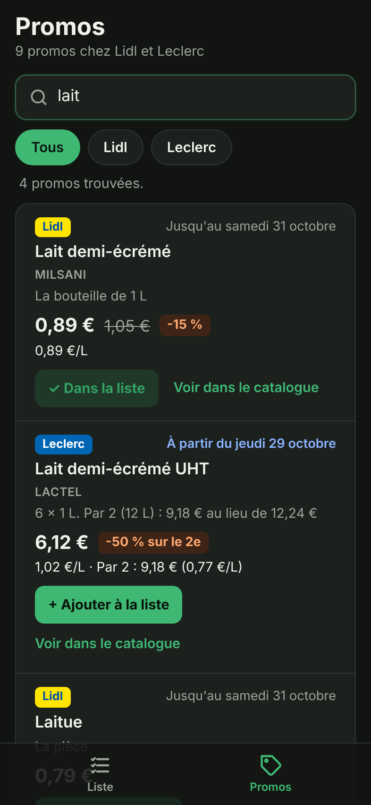

# L'appli

L'appli est une **application web** pensée pour l'iPhone : elle s'ouvre dans Safari et s'installe
sur l'écran d'accueil comme une vraie appli ([guide d'installation](installation-iphone.md)). Elle est publiée gratuitement par
GitHub Pages à l'adresse :

**https://lascampia67.github.io/promos-courses/**

Seuls nos deux comptes peuvent s'y connecter et voir la liste (voir
[liste-commune.md](liste-commune.md)).

| Connexion | Liste | Promos d'un article | Toutes les promos | Modifier un article | Mode sombre |
|---|---|---|---|---|---|
|  |  |  |  |  |  |

Les captures sont faites avec des promos d'exemple.

## Ce qu'elle sait faire (version 0.6)

- **Se connecter** avec son e-mail et son mot de passe (une seule fois : la connexion reste active).
  Lien « Mot de passe oublié ? » pour recevoir un e-mail de changement de mot de passe.
- **Ajouter un article** : écrire le nom (et, si on veut, la quantité), puis toucher **+** ou
  « OK » sur le clavier. Un article déjà dans la liste est signalé au lieu d'être ajouté en double
  (même écrit différemment : « Lait demi-écrémé » = « lait demi ecreme »).
- **Cocher** un article (le rond à gauche) : il passe dans « Dans le caddie ». Le décocher le remet
  dans la liste.
- **Modifier** un article (toucher son nom) : nom, quantité, note (« sans lactose »…), ou le supprimer.
- **Supprimer d'un geste** : glisser l'article vers la gauche, puis toucher **Supprimer** (comme
  dans Mail sur l'iPhone). Pendant 6 secondes, **Annuler** le remet à sa place, même s'il était
  dans le caddie. Toucher la ligne, ou ailleurs, la referme.

  

- **Tout retirer** : vide d'un coup les articles du caddie, une fois les courses faites.
- **En direct sur les deux téléphones** : ce que l'un fait apparaît aussitôt chez l'autre.
- **Sans réseau** (au fond du magasin) : tout continue de marcher ; un bandeau jaune le signale et
  les changements partent dès que le réseau revient.
- **Voir les promos** de chaque article (voir ci-dessous).
- **Chercher dans toutes les promos** et en ajouter une à la liste (onglet « Promos », voir ci-dessous).
- **S'installer sur l'iPhone** : dans Safari, un encadré vert explique comment l'ajouter à l'écran
  d'accueil (« Plus tard » le cache pour 14 jours). Voir [installation-iphone.md](installation-iphone.md).
- **Se mettre à jour toute seule** : à chaque ouverture, elle vérifie si une nouvelle version est
  publiée et la prend, sans jamais recharger pendant qu'on écrit.
- **Mode sombre** automatique, textes lisibles par VoiceOver, grandes zones à toucher.

## Les promos

Chaque matin, le robot range dans [`promos.json`](../promos.json) toutes les promos de Lidl
Lingolsheim et d'E.Leclerc Geispolsheim. L'appli lit ce fichier et le compare à la liste :

- un article **à acheter** qui est en promo porte une étiquette orange **« 2 promos »**, et le haut de
  l'écran indique combien d'articles sont en promo ;
- en touchant l'étiquette, on voit **chaque promo** : le magasin (Lidl en jaune, Leclerc en bleu), le
  produit et sa marque, le prix, l'ancien prix barré, la réduction (« -50 % sur le 2e »,
  « 30 % en Ticket E.Leclerc »…), le prix au kilo ou au litre, le prix si on prend le lot, la carte de
  fidélité éventuelle, et **jusqu'à quand** elle dure ; les promos **à venir** (catalogue de la semaine
  suivante) sont en bleu avec « À partir du… » ; le lien « Voir dans le catalogue » ouvre le catalogue
  officiel ;
- les promos les plus proches de l'article viennent d'abord : pour « Lait », « Lait demi-écrémé »
  passe avant « Chocolat au lait ».

### Chercher dans toutes les promos (onglet « Promos »)

La barre en bas de l'écran passe de la **Liste** aux **Promos**. L'onglet « Promos » montre toutes
les promos en cours et à venir des deux magasins :

- **chercher** : les résultats s'affichent pendant qu'on tape, et le début d'un mot suffit
  (« fro » trouve « Fromage », « nute » trouve les produits Nutella) ; les mots entiers passent
  d'abord (« lait » montre « Lait demi-écrémé » avant « Laitue ») ;
- **filtrer** par magasin : **Tous**, **Lidl** ou **Leclerc** ;
- **ajouter à la liste** : le bouton « + Ajouter à la liste » ajoute le produit, avec une **note**
  qui rappelle le magasin, le prix et la date (« Promo Lidl : 0,89 € · Jusqu'au samedi 31 octobre ») ;
  s'il est déjà dans la liste, le bouton l'indique (« ✓ Dans la liste ») ;
- les promos s'affichent par 30 ; « Voir plus de promos » montre les suivantes.

### Les familles de produits

Beaucoup de produits ne portent pas le nom de ce qu'ils sont : des chips s'appellent « Pringles »
ou « Doritos », un soda « Regular » (Coca-Cola), des couches « Changes bébé ». L'appli connaît donc
des **familles** : écrire « Chips » dans la liste trouve aussi les promos Pringles, Lay's, Doritos,
Vico, Bret's, Crusti Croc…

| On écrit | L'appli trouve aussi |
|---|---|
| Chips | Pringles, Lay's, Doritos, Vico, Bret's, Monster Munch, Crusti Croc (Lidl)… |
| Soda | Coca-Cola, Pepsi, Fanta, Orangina, Oasis, Schweppes, Freeway (Lidl)… |
| Couches | Pampers, Huggies, Lotus Baby, « Changes bébé »… |
| Shampoing | « Shampooing » (les deux orthographes), Elseve, Head & Shoulders… |
| Fromage | Camembert, comté, emmental, Babybel, Kiri, Boursin… |
| Bière, café, eau, chocolat, biscuits, céréales, lessive, dentifrice… | leurs marques les plus courantes |

Les promos qui contiennent le mot écrit passent d'abord, puis celles trouvées par la famille. Il y a
environ 50 familles, dans [`app/src/familles.js`](../app/src/familles.js) : une marque qui manque
peut y être ajoutée (il suffit de la demander). Seules les marques qui ne font qu'une sorte de
produit y sont : « Président » (beurre **et** fromage) n'y est pas, pour ne pas mélanger.

Quelques mots ne se distinguent que par l'accent : « pâtes » ne trouve pas « pâté », ni « glaces »
les « marrons glacés ».

### Bien nommer ses articles

L'appli cherche **tous les mots** de l'article dans le nom du produit ou dans sa marque (ou dans sa
famille, voir ci-dessus), sans tenir compte des majuscules, des accents ni du pluriel :

| Article | Trouve | Ne trouve pas |
|---|---|---|
| « Lait » | « Lait demi-écrémé UHT », « Chocolat au lait » | « Laitue » |
| « Œufs » | « 20 oeufs frais plein air » | |
| « Lait demi-écrémé » | « Lait demi-écrémé UHT » | « Lait de coco » |
| « Nutella » | « Pâte à tartiner » de la marque Nutella | |

Des noms **courts et simples** (« lait », « café », « lessive ») trouvent le plus de promos. Les
détails (« sans lactose », « grand format ») vont mieux dans la **note** de l'article.

### Des promos à jour

- L'appli relit les promos à chaque ouverture (au plus une fois par heure) ; la date du dernier
  passage du robot est rappelée en bas de la liste.
- **Sans réseau**, elle utilise les dernières promos lues.
- Un **bandeau jaune** prévient si les promos ont plus de 36 heures (le robot a manqué un passage :
  voir le [dépannage du README](../README.md#dépannage)), si les promos d'un magasin manquent ce matin,
  ou si elles n'ont pas pu être lues. La liste, elle, marche toujours.
- Les prix viennent des catalogues : ils peuvent varier en magasin (rupture, erreur de catalogue).

## Comment elle est faite

| Élément | Rôle |
|---|---|
| [`app/index.html`](../app/index.html) | Les écrans : connexion, liste, fenêtres. |
| [`app/src/main.js`](../app/src/main.js) | Le fonctionnement des écrans. |
| [`app/src/liste.js`](../app/src/liste.js) | Lecture et modification de la liste dans Firebase. |
| [`app/src/articles.js`](../app/src/articles.js) | Règles simples : nettoyage, doublons, tri, messages d'erreur. |
| [`app/src/promos.js`](../app/src/promos.js) | Les promos : recherche pour chaque article et dans toutes les promos, dates, prix, fraîcheur des données. |
| [`app/src/familles.js`](../app/src/familles.js) | Les familles de produits : « chips » → Pringles, Lay's, Doritos… |
| [`app/src/installation.js`](../app/src/installation.js) | Quand proposer d'installer l'appli sur l'iPhone. |
| [`app/src/firebase.js`](../app/src/firebase.js) | Connexion au projet Firebase (et à l'émulateur pour les tests). |
| [`app/src/style.css`](../app/src/style.css) | L'apparence (iPhone, mode sombre). |
| [`app/vite.config.js`](../app/vite.config.js) | Construction de l'appli ([Vite](https://vite.dev)) et mode hors ligne / installable ([PWA](https://vite-pwa-org.netlify.app)). |
| [`app/outils/generer_icones.py`](../app/outils/generer_icones.py) | Dessine les icônes de l'appli. |

Aucune donnée n'est enregistrée ailleurs que dans Firebase et dans la mémoire du téléphone. Les
promos sont lues directement dans ce dépôt public : la liste de courses n'est jamais envoyée ailleurs
que dans Firebase.

## Les tests

| Tests | Ce qu'ils vérifient | Commande |
|---|---|---|
| Logique ([`app/tests`](../app/tests)) | Nettoyage des saisies, doublons, tri, messages d'erreur ; recherche des promos (accents, pluriel, mots proches, marques, familles de produits, faux amis, début de mot, filtre par magasin), article créé depuis une promo, promos terminées ou à venir, dates, prix, fraîcheur des données ; quand proposer l'installation. | `npm test` |
| Scénarios réels ([`app/e2e`](../app/e2e)) | Un navigateur à la taille d'un iPhone utilise l'appli branchée sur l'**émulateur Firebase** (jamais la vraie base), avec deux comptes et un [fichier de promos d'exemple](../app/e2e/promos-exemple.js) aux dates du jour : connexion refusée, ajout, doublon, cochage, modification, suppression, synchronisation en direct entre deux téléphones, mode hors connexion, refus d'un compte étranger, déconnexion, étiquettes et détail des promos, promos anciennes ou incomplètes, promos indisponibles puis retrouvées, conseil d'installation dans Safari sur iPhone, glisser pour supprimer avec « Annuler », « Chips » qui trouve Pringles, recherche dans toutes les promos (filtre, ajout à la liste, affichage par 30). Sur GitHub, ils tournent dans Chrome **et Safari** (WebKit). | `npm run e2e` |
| Captures d'écran | Régénère les images de cette page dans `docs/captures/`. | `npm run captures` |

Commandes à lancer dans le dossier `app/` (Node.js 22 et Java 21 nécessaires), après `npm ci`.

## La publication

À chaque modification de l'appli sur la branche `main`, le workflow
[« Appli »](../.github/workflows/appli.yml) lance tous les tests, construit l'appli et la publie sur
GitHub Pages. Si un test échoue, rien n'est publié : l'ancienne version reste en ligne.

La publication nécessite que GitHub Pages soit activé une fois pour toutes : dans le dépôt,
**Settings** → **Pages** → **Source** : « **GitHub Actions** ».
