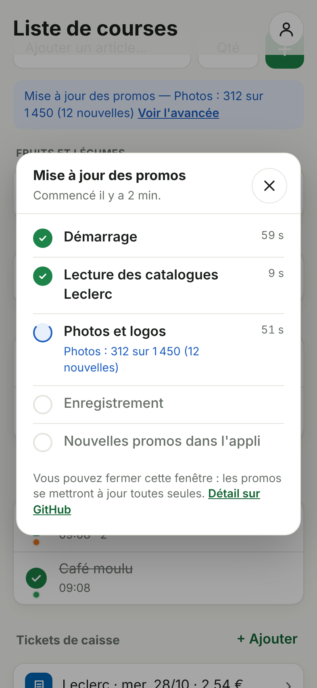

# L'appli

L'appli est une **application web** pensée pour l'iPhone : elle s'ouvre dans Safari et s'installe
sur l'écran d'accueil comme une vraie appli ([guide d'installation](installation-iphone.md)). Elle est publiée gratuitement par
GitHub Pages à l'adresse :

**https://lascampia67.github.io/promos-courses/**

Seuls nos deux comptes peuvent s'y connecter et voir la liste (voir
[liste-commune.md](liste-commune.md)).

| Connexion | Liste | Promos d'un article | En écrivant un article | Modifier un article | Mon compte | Mode sombre |
|---|---|---|---|---|---|---|
|  |  |  |  |  |  |  |

Les captures sont faites avec des promos d'exemple et des prénoms fictifs (Camille en vert, Alex en orange).

## Ce qu'elle sait faire (version 0.12)

- **Se connecter** avec son e-mail et son mot de passe (une seule fois : la connexion reste active).
  Lien « Mot de passe oublié ? » pour recevoir un e-mail de changement de mot de passe.
- **Ajouter un article** : écrire le nom (et, si on veut, la quantité), puis toucher **+** ou
  « OK » sur le clavier. Un article déjà dans la liste est signalé au lieu d'être ajouté en double
  (même écrit différemment : « Lait demi-écrémé » = « lait demi ecreme »).
- **Rangée par rayon**, dans l'ordre où on traverse le magasin : fruits et légumes, boulangerie,
  épicerie salée, épicerie sucrée, boissons, hygiène et beauté, entretien, bébé, animaux, viande et
  poisson, frais, et le **surgelé en dernier** pour qu'il reste froid ; « Autres » pour ce que l'appli
  ne reconnaît pas. Le rayon est deviné d'après le nom (« Chocolat au lait » va avec le chocolat,
  « Lait au chocolat » avec le lait ; « Pringles » avec les chips). S'il est mal deviné, on le
  change dans la fenêtre de l'article (« Rayon ») : c'est retenu pour ce nom d'article, sur les deux
  téléphones (réglage `rayons`, voir [liste-commune.md](liste-commune.md)).
- **Cocher** un article (le rond à gauche) : il passe dans « Dans le caddie ». Le décocher le remet
  dans la liste.
- **Qui l'a ajouté, et quand** : sous le rond à cocher, une petite **pastille de couleur** dit qui
  a ajouté l'article ; sous le nom, la date et l'heure d'ajout (« 13:38 » aujourd'hui, « hier 08:05 »,
  « jeu. 09:15 » cette semaine, « 12/10 09:15 » avant), puis la quantité et la note.
- **Mon compte** (le bonhomme en haut à droite) : chacun écrit son **prénom** et choisit **sa
  couleur** parmi six ; la légende dessous rappelle qui a quelle couleur. Tant qu'un compte n'a pas
  choisi, il a une couleur donnée d'office (la même sur les deux téléphones).
- **Modifier** un article (toucher son nom) : nom, quantité, note (« sans lactose »…), ou le supprimer.
  La fenêtre rappelle qui l'a ajouté et quand.
- **Supprimer d'un geste** : glisser l'article vers la gauche, puis toucher **Supprimer** (comme
  dans Mail sur l'iPhone). Pendant 6 secondes, **Annuler** le remet à sa place, même s'il était
  dans le caddie. Toucher la ligne, ou ailleurs, la referme.

  

- **Tout retirer** : vide d'un coup les articles du caddie, une fois les courses faites.
- **En direct sur les deux téléphones** : ce que l'un fait apparaît aussitôt chez l'autre.
- **Sans réseau** (au fond du magasin) : tout continue de marcher ; un bandeau jaune le signale et
  les changements partent dès que le réseau revient.
- **Voir la promo** d'un article ajouté depuis les promos (voir ci-dessous).
- **Voir les promos en écrivant** un article, et en ajouter une à la liste d'un geste (voir ci-dessous).
- **S'installer sur l'iPhone** : dans Safari, un encadré vert explique comment l'ajouter à l'écran
  d'accueil (« Plus tard » le cache pour 14 jours). Voir [installation-iphone.md](installation-iphone.md).
- **Se mettre à jour toute seule** : à chaque ouverture, elle vérifie si une nouvelle version est
  publiée et la prend, sans jamais recharger pendant qu'on écrit.
- **Garder les tickets de caisse** (voir ci-dessous).
- **Des gestes doux** : un article coché ou supprimé glisse et s'efface, celui qui arrive (ajouté,
  coché, ou venu de l'autre téléphone) apparaît en douceur, les fenêtres s'ouvrent en fondu ; rien de
  tout cela si l'iPhone est réglé sur « Réduire les animations ».
- **Une jolie ouverture** : l'appli installée s'ouvre sur son logo (en clair ou en sombre) au lieu
  d'un écran vide, puis la liste apparaît en fondu.
- **Mode sombre** automatique, textes lisibles par VoiceOver, grandes zones à toucher.

## Les tickets de caisse

Les tickets papier finissent souvent à la poubelle : l'appli les garde, pour vérifier un prix ou
retrouver une preuve d'achat (garantie, retour d'un produit). Ils sont rangés **en bas de la
liste**, sous le caddie, et visibles sur les deux téléphones.

| Les derniers tickets, sous la liste | Ajouter un ticket | Un ticket en grand |
|---|---|---|
|  |  |  |

- **Ajouter** : « + Ajouter » à côté de « Tickets de caisse ». L'iPhone propose de **prendre une
  photo**, de choisir dans la **photothèque** (une capture d'écran, par exemple celle du ticket dans
  l'appli E.Leclerc) ou dans **Fichiers** (le **PDF** du ticket). Après « Tout retirer »
  dans le caddie, l'appli propose aussi d'ajouter le ticket des courses.
- **Lu tout seul** : l'appli lit le ticket et remplit le **magasin**, la **date** et le **total**
  (« Date et total lus sur le ticket : vérifiez. »). Un PDF est lu aussitôt ; une photo en quelques
  secondes, et on peut enregistrer sans attendre. Ce qu'on a changé à la main n'est jamais remplacé.
  La lecture se fait **sur le téléphone** : le ticket n'est envoyé nulle part pour être lu. La
  première lecture d'une photo télécharge l'outil de lecture (environ 4 Mo, une seule fois) ; il
  marche ensuite sans réseau.
- **Ce qu'on vérifie** : le magasin (Leclerc d'office, ou « Autre » pour un ticket d'ailleurs), la
  date des courses (aujourd'hui d'office), et si on veut le montant et une note (« garantie de la
  cafetière »). Si rien n'est lisible (photo floue, de travers), on complète à la main.
- **Sous la liste** : les 3 derniers tickets (« Leclerc · mar. 27/10 · 54,30 € ») ; « Voir les 12
  tickets » les montre tous, classés par mois.
- **En grand** : toucher un ticket l'ouvre (la photo, ou chaque page du PDF) ; on peut zoomer avec
  deux doigts. **Partager** ouvre la feuille de partage de l'iPhone (Enregistrer dans Fichiers,
  Mail, AirDrop…), avec le fichier d'origine pour un PDF. **Modifier** corrige le magasin, la date,
  le montant ou la note ; **Supprimer** l'efface pour de bon (après confirmation).
- **Photos allégées** : une photo est réduite à 1 400 pixels de large (assez pour lire chaque ligne)
  et enregistrée en JPEG, soit 200 à 400 Ko. Un PDF est gardé tel quel (5 Mo au plus).
- **Sans réseau** : le ticket est gardé sur le téléphone (« envoi en cours… ») et part au retour du
  réseau. Un ticket ajouté par l'autre téléphone s'ouvre une première fois avec du réseau ; ensuite
  il reste sur le téléphone.
- **Privés** : comme la liste, les tickets sont dans Firebase et seuls nos deux comptes y ont accès.
  Ils ne sont **jamais** dans ce dépôt GitHub, qui est public. Voir
  [liste-commune.md](liste-commune.md#collection-tickets--les-tickets-de-caisse).

## Les promos

Chaque matin, le robot range dans [`promos.json`](../promos.json) toutes les promos d'E.Leclerc
Geispolsheim. L'appli lit ce fichier :

- en écrivant un article, les promos qui correspondent s'affichent (voir plus bas) ; **« + Ajouter »**
  sur l'une d'elles ajoute l'article **avec cette promo** ;
- un article ajouté ainsi porte à droite une étiquette orange **« Promo »**, et dessous, en petit, le
  **type de promo**, sans avoir à l'ouvrir : « -60 % sur le 2e » (en prenant plusieurs), « -20 % en
  caisse », « 30 % sur la carte » (Ticket E.Leclerc), « -25 % avec la carte », ou le prix s'il n'y a pas de réduction particulière ; « dès le 29 oct. » s'ajoute pour une promo
  qui n'a pas encore commencé ; quand la promo n'est plus dans les catalogues, « Promo terminée » ;
- un article **écrit à la main** (« + » ou « OK ») n'affiche **aucune promo**, même s'il y en a :
  la liste reste légère ; pour les voir, il suffit d'écrire l'article dans le champ ;
- les articles ajoutés depuis une promo par les versions précédentes retrouvent leur promo d'après
  leur note (« Leclerc · 2,25 € ») ;
- en touchant l'étiquette, on voit **cette promo**, rangée pour se lire d'un coup d'œil (comme dans
  les résultats quand on écrit un article) :
  1. à gauche, la **photo du produit** ; à côté, **jusqu'à quand** elle dure (« Jusqu'au sam.
     31 oct. », « Dernier jour » ; une promo **à venir**, du catalogue suivant, est en bleu : « Dès
     jeu. 29 oct. ») et, dans le coin, le **logo de la marque** (voir « Les photos des produits et
     les logos des marques » ci-dessous) ;
  2. le nom du produit ;
  3. sa taille, sur une ligne (« 2 x 300 ml », sans les prix répétés) ;
  4. le prix payé en caisse, l'ancien prix barré, le prix au kilo, et à droite « Catalogue », qui
     ouvre le catalogue officiel ;
  5. le **type de promo**, dans une pastille de couleur, et le détail utile (voir ci-dessous) ;
- une même promo déclinée en plusieurs produits (« Au choix : Douceur, Nutrition, Purifiant… »), que
  le catalogue donne en plusieurs offres, n'est montrée **qu'une fois** ;
- en écrivant un article, les promos les plus proches viennent d'abord : pour « Lait », « Lait
  demi-écrémé » passe avant « Chocolat au lait ».

### Les photos des produits et les logos des marques

Chaque promo montre la photo de son produit, prise dans le catalogue officiel Leclerc, à condition
d'être **sûr que c'est la bonne** : la photo du produit seul (pas une photo d'ambiance, un plat ou
une mise en scène), qui porte dans son nom le **code-barres** du produit ou exactement son nom.
Sinon, un petit emplacement neutre (un sac) : mieux vaut pas de photo qu'une photo trompeuse. C'est
le cas des produits frais (boucherie, fromage à la coupe, poisson) et des promos sur toute une
marque.

Les photos du catalogue pèsent 2 à 6 Mo chacune : le robot en fait une fois pour toutes une petite
vignette (256 pixels, une quinzaine de Ko). L'appli les garde sur le téléphone : elles s'affichent
aussi sans réseau, une fois vues. Détails : [sources.md](sources.md#photos-des-produits).

En haut à droite de chaque promo, le **logo de sa marque**, celui que le catalogue Leclerc donne pour
cette marque (une marque sur deux environ) ; sinon, le nom de la marque écrit en petit au même
endroit. Le nom du produit, lui, est écrit seul (sans la marque à la suite). Les logos aussi restent
sur le téléphone. Détails : [sources.md](sources.md#logos-des-marques).

### Comprendre le prix : où va la réduction

Sous le prix, une pastille de couleur donne le type de promo, suivie du détail utile. Le gros prix
est toujours celui **payé en caisse**.

| Pastille | Ce que ça veut dire | Détail à côté |
|---|---|---|
| 🟩 **-15 % en caisse** | Le prix affiché est déjà réduit ; l'ancien prix est barré. | |
| 🟩 **-50 % sur le 2e**, **2 + 1 offert** | Le gros prix est celui d'un seul ; la réduction se fait en caisse en prenant le lot. | « 9,18 € les 2 (0,77 €/L) » |
| 🟦 **30 % sur la carte** | Ticket E.Leclerc : on paie le prix affiché en caisse ; une partie revient sur la carte, à dépenser plus tard. | « revient à 1,65 € » |
| 🟦 **-25 % avec la carte** | Réduction en caisse, réservée aux porteurs de la carte E.Leclerc. | |

Sans pastille : c'est le prix du catalogue, sans réduction particulière. Le même type de promo est
écrit en petit sous l'étiquette « Promo » de la liste.

### Les promos en écrivant un article

Dès 2 lettres écrites dans « Ajouter un article… », les promos qui correspondent s'affichent sous
le champ, à la place de la liste (la croix ✕ efface et fait revenir la liste) :

- les résultats suivent ce qu'on tape, et le début d'un mot suffit (« fro » trouve « Fromage »,
  « nute » trouve les produits Nutella) ; les mots entiers passent d'abord (« lait » montre « Lait
  demi-écrémé » avant « Laitue ») ;
- **« + »** ou **« OK »** sur le clavier ajoute ce qu'on a écrit, **qu'il y ait des promos ou non** ;
- le bouton **« + Ajouter »** d'une promo ajoute ce produit-là, avec une **note** courte qui
  rappelle le magasin et le prix (« Leclerc · 0,89 € ») ; le type de promo et ses dates s'affichent,
  toujours à jour, sous l'étiquette de l'article ;
  s'il est déjà dans la liste, le bouton l'indique (« ✓ Dans la liste ») ;
- les promos s'affichent par 30 ; « Voir plus de promos » montre les suivantes.

### Les familles de produits

Beaucoup de produits ne portent pas le nom de ce qu'ils sont : des chips s'appellent « Pringles »
ou « Doritos », un soda « Regular » (Coca-Cola), des couches « Changes bébé ». L'appli connaît donc
des **familles** : écrire « Chips » dans la liste trouve aussi les promos Pringles, Lay's, Doritos,
Vico, Bret's…

| On écrit | L'appli trouve aussi |
|---|---|
| Chips | Pringles, Lay's, Doritos, Vico, Bret's, Monster Munch… |
| Soda | Coca-Cola, Pepsi, Fanta, Orangina, Oasis, Schweppes… |
| Couches | Pampers, Huggies, Lotus Baby, « Changes bébé »… |
| Shampoing | « Shampooing » (les deux orthographes), Elseve, Head & Shoulders… |
| Fromage | Camembert, comté, emmental, Babybel, Kiri, Boursin… |
| Bière, café, eau, chocolat, biscuits, céréales, lessive, dentifrice… | leurs marques les plus courantes |

Les promos qui contiennent le mot écrit passent d'abord, puis celles trouvées par la famille. Il y a
environ 50 familles, dans [`app/src/familles.js`](../app/src/familles.js) : une marque qui manque
peut y être ajoutée (il suffit de la demander). Seules les marques qui ne font qu'une sorte de
produit y sont : « Président » (beurre **et** fromage) n'y est pas, pour ne pas mélanger.

Quelques mots ne se distinguent que par l'accent : « pâtes » ne trouve pas « pâté », ni « glaces »
les « marrons glacés ».

### Bien nommer ses articles

L'appli cherche **tous les mots** de l'article dans le nom du produit ou dans sa marque (ou dans sa
famille, voir ci-dessus), sans tenir compte des majuscules, des accents ni du pluriel :

| Article | Trouve | Ne trouve pas |
|---|---|---|
| « Lait » | « Lait demi-écrémé UHT », « Chocolat au lait » | « Laitue » |
| « Œufs » | « 20 oeufs frais plein air » | |
| « Lait demi-écrémé » | « Lait demi-écrémé UHT » | « Lait de coco » |
| « Nutella » | « Pâte à tartiner » de la marque Nutella | |

Des noms **courts et simples** (« lait », « café », « lessive ») trouvent le plus de promos. Les
détails (« sans lactose », « grand format ») vont mieux dans la **note** de l'article.

### Des promos à jour

- L'appli relit les promos à chaque ouverture (au plus une fois par heure). Tout en bas, seule la
  version de l'appli est rappelée (« v0.9.0 ») ; la date des promos n'est affichée que si elles
  sont trop anciennes (voir ci-dessous).
- **Sans réseau**, elle utilise les dernières promos lues.
- Un **bandeau jaune** prévient si les promos ont plus de 36 heures (le robot a manqué un passage :
  voir le [dépannage du README](../README.md#dépannage)), si les promos d'un magasin manquent ce matin,
  ou si elles n'ont pas pu être lues. La liste, elle, marche toujours.
- Les prix viennent des catalogues : ils peuvent varier en magasin (rupture, erreur de catalogue).

### Mettre à jour les promos sans attendre

Le robot passe chaque matin, mais GitHub le lance parfois avec plusieurs heures de retard. Dans
**Mon compte** → **Promos**, le bouton **« Mettre à jour les promos »** le lance tout de suite, et
la fenêtre **« Mise à jour des promos »** montre où il en est, étape par étape :

| Étape | Ce qui se passe | Ce que dit le robot |
|---|---|---|
| **Démarrage** | GitHub trouve une machine (quelques secondes, parfois une minute), y installe le robot et reprend les photos déjà faites. | « En attente d'une machine GitHub… » |
| **Lecture des catalogues Leclerc** | Le robot lit chaque catalogue du magasin (ceux qui n'ont pas changé sont repris tels quels). | « Catalogue 3 sur 9 : Un automne en fête » |
| **Photos et logos** | Il fait les vignettes des nouveaux logos de marque, puis des nouvelles photos (au plus une heure). | « Logos : 12 sur 239 », « Photos : 312 sur 1 450 (12 nouvelles) » |
| **Enregistrement** | Il enregistre les photos et les promos sur GitHub. | |
| **Nouvelles promos dans l'appli** | L'appli lit les promos qu'il vient d'écrire. | |

- Chaque étape finie est cochée en vert, avec sa durée ; celle en cours tourne en bleu ; une étape
  en panne est marquée d'une croix rouge (les promos d'avant restent affichées). « Détail sur
  GitHub » ouvre le passage sur GitHub.
- On peut fermer la fenêtre : en haut de la liste, une ligne bleue suit le robot (« Mise à jour des
  promos — Photos : 312 sur 1 450 ») avec **« Voir l'avancée »** pour la rouvrir ; à la fin,
  « Promos mises à jour. ». D'habitude 2 à 5 minutes, jusqu'à une heure les jours où il y a beaucoup
  de nouvelles photos ;
- s'il travaille déjà, l'appli suit ce passage au lieu d'en lancer un autre ;
- chaque passage relit le site Leclerc (toujours avec des pauses) : le bouton sert quand les promos
  ne sont pas à jour, pas plusieurs fois par jour.

**La première fois**, il faut une **clé GitHub** qui sert seulement à lancer ce robot. Elle est
gardée dans notre base Firebase (les deux téléphones l'utilisent), jamais dans ce dépôt public :

1. Dans l'appli, toucher **« Mettre à jour les promos »**, puis **« Créer la clé sur GitHub »** : la
   page de GitHub s'ouvre, déjà remplie (nom « Bouton robot promos », durée d'un an, droit
   **Actions : Read and write**). Se connecter à GitHub si besoin.
2. Sous **Repository access**, choisir **Only select repositories**, puis le dépôt
   **promos-courses**.
3. Vérifier sous **Permissions** que **Actions** est sur **Read and write** (rien d'autre).
4. Toucher **Generate token**, confirmer, puis **copier** la clé (elle commence par `github_pat_`).
5. Revenir dans l'appli, la coller dans **« Clé GitHub »** et toucher **« Enregistrer et lancer »**.

Cette clé ne peut que lancer, suivre ou arrêter les robots de ce dépôt : elle ne peut rien modifier
dans le code, les promos ou la liste. **Dans un an**, GitHub la périme : l'appli dit alors « Clé
GitHub refusée ou expirée » et propose d'en coller une nouvelle (mêmes étapes). Pour la retirer à
tout moment : sur GitHub, **Settings** → **Developer settings** → **Personal access tokens** →
**Fine-grained tokens** → **Delete**.

## Comment elle est faite

| Élément | Rôle |
|---|---|
| [`app/index.html`](../app/index.html) | Les écrans : connexion, liste, fenêtres. |
| [`app/src/main.js`](../app/src/main.js) | Le fonctionnement des écrans. |
| [`app/src/liste.js`](../app/src/liste.js) | Lecture et modification de la liste dans Firebase. |
| [`app/src/articles.js`](../app/src/articles.js) | Règles simples : nettoyage, doublons, tri, messages d'erreur. |
| [`app/src/rayons.js`](../app/src/rayons.js) | Les rayons du magasin, dans l'ordre, et le rayon de chaque article d'après son nom. |
| [`app/src/membres.js`](../app/src/membres.js) | Qui a ajouté quoi : couleur et prénom de chacun, date d'ajout en clair. |
| [`app/src/tickets.js`](../app/src/tickets.js) | Les tickets de caisse : découpage du fichier, montant, date, classement par mois, et ce qu'on trouve dans le texte d'un ticket (magasin, date, total). |
| [`app/src/fichiers.js`](../app/src/fichiers.js) | Photo allégée avant l'envoi, affichage en grand, partage, texte du ticket. |
| [`app/src/pdf.js`](../app/src/pdf.js) | Affichage et texte des tickets en PDF ([PDF.js](https://mozilla.github.io/pdf.js/), chargé seulement à l'ouverture d'un PDF). |
| [`app/src/lecture.js`](../app/src/lecture.js) | Lecture d'une photo de ticket sur le téléphone ([Tesseract.js](https://tesseract.projectnaptha.com), en français ; ses fichiers sont servis par l'appli, dans `ocr/`, chargés à la première lecture). |
| [`app/src/promos.js`](../app/src/promos.js) | Les promos : recherche pour chaque article et dans toutes les promos, dates, prix, fraîcheur des données. |
| [`app/src/robot.js`](../app/src/robot.js) | « Mettre à jour les promos » : lancer et suivre le robot avec l'API de GitHub, puis lire les promos qu'il vient d'écrire. |
| [`app/src/familles.js`](../app/src/familles.js) | Les familles de produits : « chips » → Pringles, Lay's, Doritos… |
| [`app/src/installation.js`](../app/src/installation.js) | Quand proposer d'installer l'appli sur l'iPhone. |
| [`app/src/firebase.js`](../app/src/firebase.js) | Connexion au projet Firebase (et à l'émulateur pour les tests). |
| [`app/src/style.css`](../app/src/style.css) | L'apparence (iPhone, mode sombre). |
| [`app/vite.config.js`](../app/vite.config.js) | Construction de l'appli ([Vite](https://vite.dev)) et mode hors ligne / installable ([PWA](https://vite-pwa-org.netlify.app)). |
| [`app/outils/generer_icones.py`](../app/outils/generer_icones.py) | Dessine les icônes de l'appli. |
| [`app/outils/generer_ecrans.py`](../app/outils/generer_ecrans.py) | Dessine les écrans de démarrage de l'iPhone (un par taille d'écran, clair et sombre). |

Aucune donnée n'est enregistrée ailleurs que dans Firebase et dans la mémoire du téléphone. Les
prénoms et les couleurs, en particulier, ne sont que dans Firebase, jamais dans ce dépôt public. Les
promos sont lues directement dans ce dépôt public : la liste de courses n'est jamais envoyée ailleurs
que dans Firebase.

## Les tests

| Tests | Ce qu'ils vérifient | Commande |
|---|---|---|
| Logique ([`app/tests`](../app/tests)) | Nettoyage des saisies, doublons, tri, messages d'erreur ; couleur et prénom de chacun, date d'ajout en clair ; tickets de caisse (découpage et recollage du fichier, montant, date, classement par mois, taille des photos, total et date lus sur un ticket même mal lu, faux totaux et dates impossibles écartés) ; recherche des promos (accents, pluriel, mots proches, marques, familles de produits, faux amis, début de mot), article créé depuis une promo, où va la réduction (caisse, lot, carte E.Leclerc), description sans les prix répétés, promos terminées ou à venir, dates, prix, fraîcheur des données ; quand proposer l'installation ; lancement et suivi du robot (clé reconnue, page de GitHub déjà remplie, refus expliqués, passage en cours ou fini, étapes et durées, dernière nouvelle du robot, noms des étapes identiques à ceux du robot sur GitHub, promos fraîches). | `npm test` |
| Scénarios réels ([`app/e2e`](../app/e2e)) | Un navigateur à la taille d'un iPhone utilise l'appli branchée sur l'**émulateur Firebase** (jamais la vraie base), avec deux comptes et un [fichier de promos d'exemple](../app/e2e/promos-exemple.js) aux dates du jour : connexion refusée, ajout, doublon, cochage, modification, suppression, synchronisation en direct entre deux téléphones, mode hors connexion, refus d'un compte étranger, déconnexion, promo choisie avec « + Ajouter » affichée à droite de l'article (rien pour un article écrit à la main, promo retrouvée pour les articles des versions précédentes, « Promo terminée »), promos anciennes ou incomplètes, promos indisponibles puis retrouvées, conseil d'installation dans Safari sur iPhone, glisser pour supprimer avec « Annuler », « Chips » qui trouve Pringles, promos affichées en écrivant (mot entier d'abord, ajout d'une promo ou du texte écrit, affichage par 30), prix expliqué (sur la carte E.Leclerc, ou en caisse avec la carte), prénom et couleur choisis sur un téléphone et vus sur l'autre (pastille, heure d'ajout), photo de chaque promo (ou emplacement neutre sans photo sûre ou introuvable), « Mettre à jour les promos » avec un GitHub simulé ([`github-exemple.js`](../app/e2e/github-exemple.js) : clé demandée une seule fois et retrouvée sur l'autre téléphone, avancée étape par étape avec les nouvelles du robot, bandeau « Voir l'avancée », promos rechargées, clé expirée), tickets de caisse en photo et en PDF ([fichiers d'exemple](../app/e2e/fichiers-exemple.js) : lus tout seuls — date et total — sans changer ce qu'on a choisi, vus en grand sur l'autre téléphone, corrigés, partagés, supprimés, proposés après « Tout retirer », sans réseau, refusés à un compte étranger). Sur GitHub, ils tournent dans Chrome **et Safari** (WebKit). | `npm run e2e` |
| Accessibilité ([`app/e2e/accessibilite.spec.js`](../app/e2e/accessibilite.spec.js)) | Chaque écran (connexion, liste, recherche, promo, fenêtres, tickets), en mode clair et sombre, vérifié avec [axe](https://github.com/dequelabs/axe-core) selon les règles WCAG 2.2 niveau AA : contrastes, noms lus par VoiceOver, champs… | `npm run e2e` |
| Rapidité ([Lighthouse](https://developer.chrome.com/docs/lighthouse)) | L'appli construite, mesurée sur un téléphone simulé : rapidité (85 sur 100 au moins), accessibilité (100), bonnes pratiques (95 au moins). Sur GitHub, à chaque modification (rapports gardés 14 jours). | `npm run build && npm run qualite` |
| Captures d'écran | Régénère les images de cette page dans `docs/captures/`. | `npm run captures` |

Commandes à lancer dans le dossier `app/` (Node.js 22 et Java 21 nécessaires), après `npm ci`.

## La publication

À chaque modification de l'appli sur la branche `main`, le workflow
[« Appli »](../.github/workflows/appli.yml) lance tous les tests, construit l'appli et la publie sur
GitHub Pages. Si un test échoue, rien n'est publié : l'ancienne version reste en ligne.

La publication nécessite que GitHub Pages soit activé une fois pour toutes : dans le dépôt,
**Settings** → **Pages** → **Source** : « **GitHub Actions** ».
