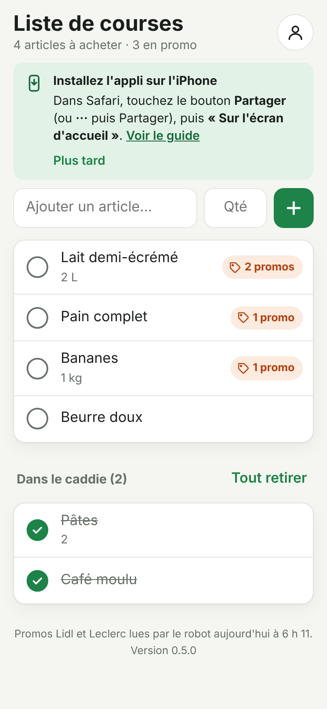

# Installer l'appli sur l'iPhone

L'appli s'ajoute à l'écran d'accueil comme une vraie appli, **gratuitement et sans l'App Store**.
Une fois installée :

- elle s'ouvre d'un geste depuis son icône **Courses**, en plein écran, sans barre d'adresse ;
- elle marche **sans réseau** (au fond du magasin) avec la liste et les dernières promos ;
- elle garde la connexion, même si on ne l'ouvre pas pendant des semaines (Safari, lui, peut effacer
  les données d'un site qu'on n'a pas visité depuis quelques jours) ;
- elle se **met à jour toute seule** quand une nouvelle version est publiée.

## Les étapes (sur chacun des deux iPhones)

1. Ouvrir **Safari** (pas en navigation privée) à l'adresse
   **https://lascampia67.github.io/promos-courses/**, et se connecter.
2. Toucher le bouton **Partager** : un carré avec une flèche vers le haut.
   Selon la version d'iOS, il est en bas de l'écran, ou dans le menu **« ··· »** à côté de l'adresse.
3. Dans la liste qui s'ouvre, choisir **« Sur l'écran d'accueil »**. S'il n'apparaît pas tout de
   suite, faire défiler la liste ou toucher « Plus ».
4. Laisser le nom **Courses** et l'option **« Ouvrir comme app web »** activée (si elle est
   proposée), puis toucher **Ajouter**.
5. Sur l'écran d'accueil, ouvrir l'icône **Courses** et **se connecter une fois** : l'appli
   installée ne partage pas la connexion de Safari.

C'est fini : on peut fermer l'onglet dans Safari et n'utiliser que l'icône.

## Vérifier que tout va bien

- L'appli s'ouvre en plein écran, sans la barre d'adresse de Safari.
- En bas de la liste : la date des promos (« lues par le robot aujourd'hui à… ») et le numéro de
  version.
- En mode avion, la liste et les promos restent là ; les changements partent au retour du réseau.

## Les mises à jour

Rien à faire : à chaque ouverture, l'appli regarde si une nouvelle version est publiée et la prend
d'elle-même (elle attend qu'on ait fini d'écrire). Pour forcer la mise à jour : fermer l'appli
(balayer depuis le bas de l'écran et s'arrêter au milieu, puis faire glisser **Courses** vers le
haut) et la rouvrir.

## Désinstaller

Appui long sur l'icône **Courses** → **Supprimer l'app**. La liste de courses n'est pas perdue :
elle est enregistrée dans Firebase, et on la retrouve en réinstallant l'appli.

## En cas de problème

| Problème | Solution |
|---|---|
| « Sur l'écran d'accueil » n'apparaît pas | Vérifier qu'on est dans **Safari** et pas en navigation privée ; faire défiler la liste du bouton Partager jusqu'en bas. |
| L'appli installée demande de se connecter | C'est normal la première fois : elle ne partage pas la connexion de Safari. |
| Une ancienne version s'affiche (numéro en bas de la liste) | Fermer complètement l'appli et la rouvrir, avec du réseau. |
| L'icône est blanche ou n'a pas le bon nom | Supprimer l'icône et refaire l'ajout depuis Safari. |
